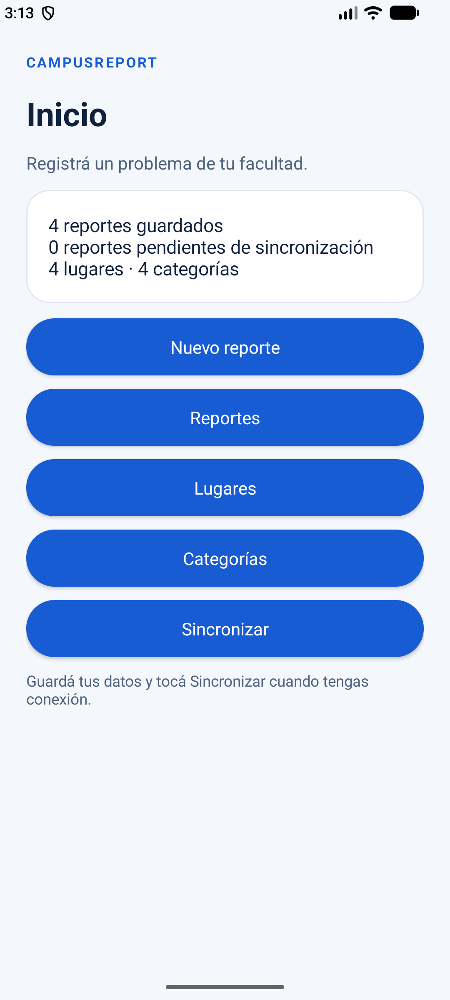
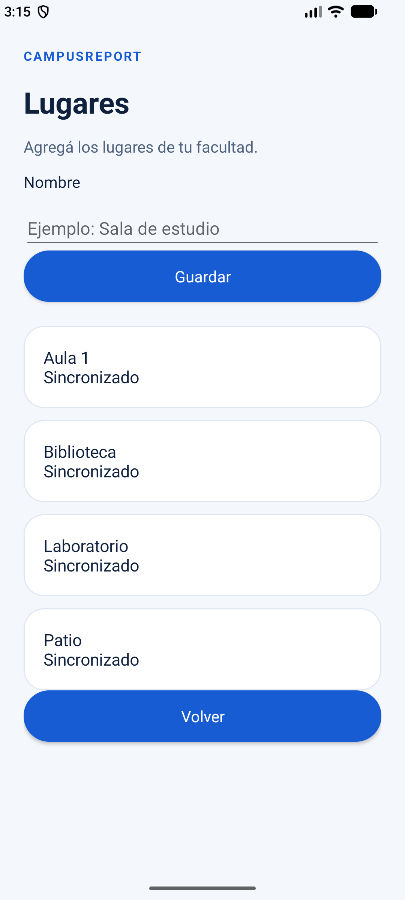
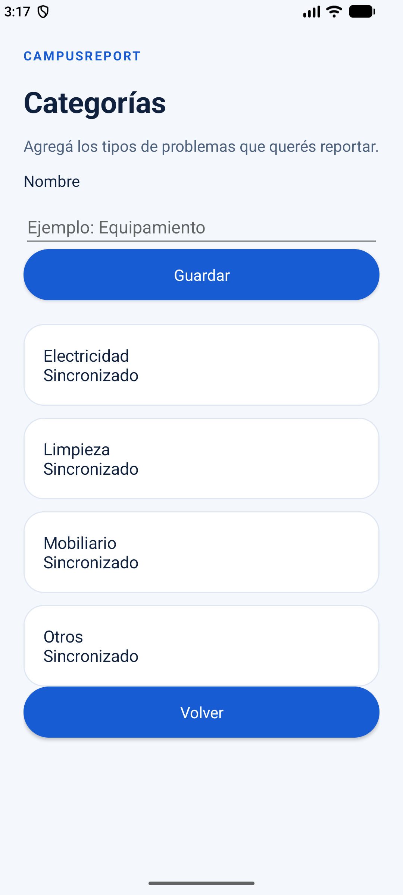
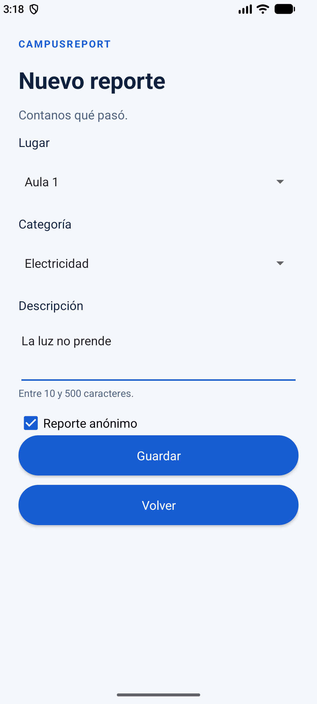
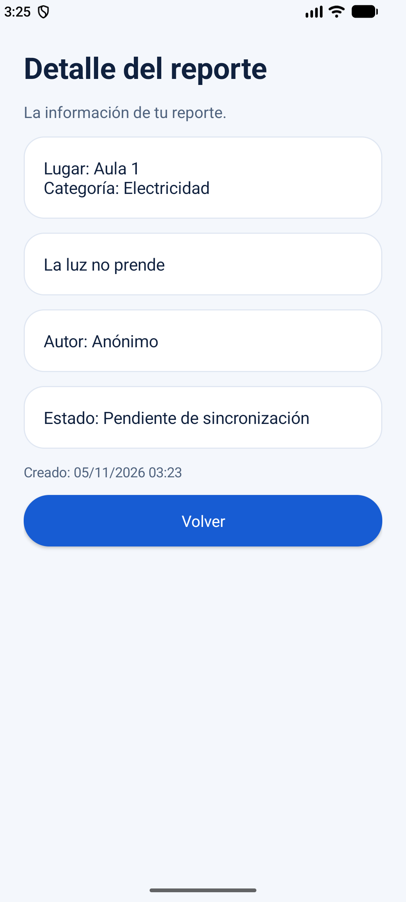
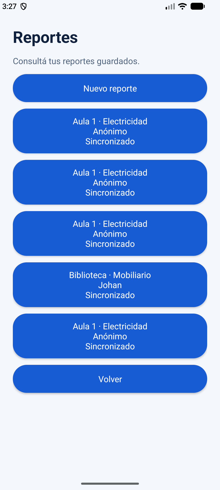

# Capturas reales de CampusReport 0.4.0

Integrantes: Johan Escurra y Roger Báez. Capturas obtenidas del emulador Android en la rama de integración.

Este anexo complementa la [documentación técnica](../complementos/CampusReport_Documentacion_Tecnica_Actualizada.md) y la [matriz de cobertura](../complementos/CampusReport_Matriz_y_Capturas_Pendientes.md), sin sustituir los Word ya incluidos en el repositorio.

## Pantallas documentadas

### 1. Inicio

Pantalla principal con navegación a las funciones de registro, consulta, catálogos y sincronización.

### 2. Lugares

Listado de lugares y formulario para registrar referencias.

### 3. Categorías

Listado de categorías y formulario para registrar referencias.

### 4. Nuevo reporte

Selección de lugar y categoría, descripción y controles de identificación o anonimato.

### 5. Detalle de reporte

Consulta de un reporte guardado, incluyendo sus campos de información.

### 6. Reporte sincronizado

Evidencia visual de un reporte que figura como sincronizado en la aplicación.

## Alcance y limitaciones de la evidencia

Hay **seis capturas reales**. No se incluyeron imágenes separadas de un reporte todavía pendiente (nombre previsto: `05_reporte_pendiente.png`) ni del mensaje emitido al pulsar Sincronizar (`07_sincronizacion.png`). Por tanto, **no debe afirmarse que esas dos transiciones están demostradas mediante capturas**.

La sincronización offline/online también está abordada en las pruebas automatizadas ya documentadas en `../../evidencias/`; estas no sustituyen por sí mismas las capturas faltantes.

El esquema de tablas, el flujo HTTP y las limitaciones de la aplicación se describen en los archivos técnicos. No se modificó el código para generar este anexo.
