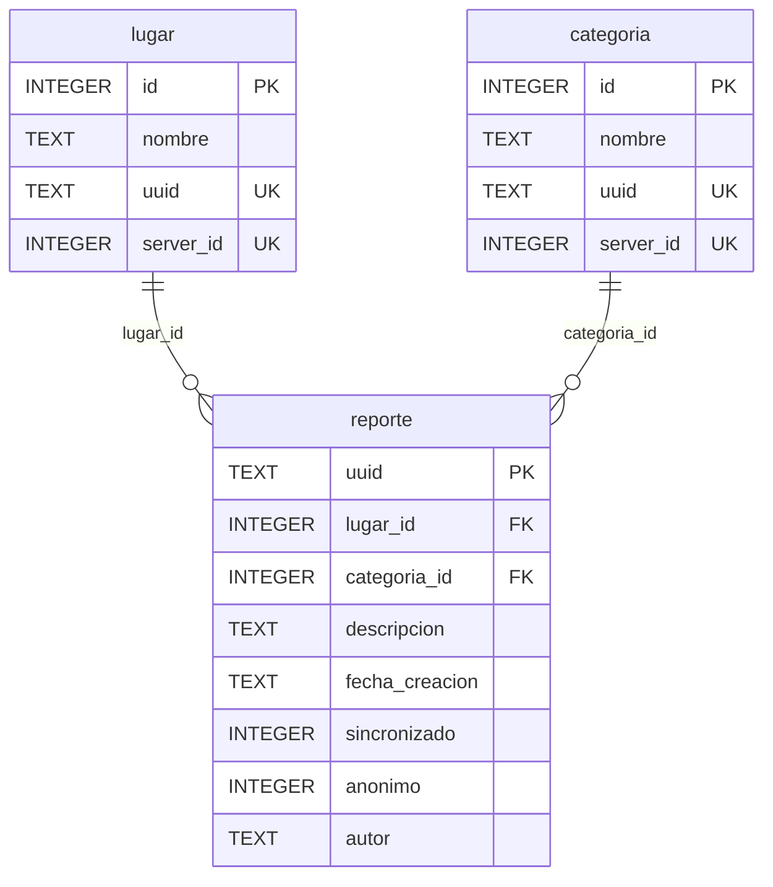
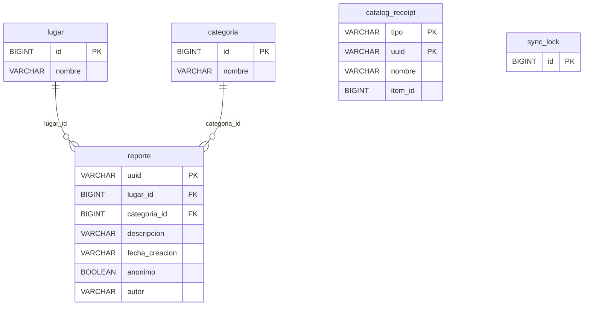

# CampusReport 0.4.0 — diagramas y matriz de cobertura (complemento)

**Base comprobada:** `campusreport-semana1` commit `f6293bbbea6f4a43e91d8b3f5a46ce142f49f52f`; la rama `campusreport-integracion-final` conserva ese código.  
**Objeto:** completar los requisitos de diagramas y trazabilidad sin volver a elaborar el manual y la presentación existentes en `docs/cierre/archivos`.

## SQLite — `CampusDb.java`, esquema versión 3

Los nuevos lugares y categorías comienzan con ID local negativo; tras el envío, reciben `server_id` positivo sin cambiar su ID local. `reporte.uuid` identifica el registro y `sincronizado` indica pendiente (0) o confirmado (1).

## H2 — `schema.sql`, versión 0.4.0

`catalog_receipt` tiene clave primaria compuesta `(tipo, uuid)`. Su `item_id` es una **asociación lógica** con lugar o categoría según `tipo`, pero `schema.sql` **no declara una FK SQL** para ella. `sync_lock` es una tabla independiente de bloqueo transaccional. Los campos `sincronizado` y `server_id` son propios de SQLite.

## Cobertura de las pantallas y controles

| Pantalla | Funciones/controles implementados | Sección sugerida |
| --- | --- | --- |
| Inicio | Nuevo reporte, Reportes, Lugares, Categorías, Sincronizar, contadores/mensaje | Funcionalidades y sincronización |
| Lugares | Nombre, Guardar, listado, Volver | Componentes Android y almacenamiento |
| Categorías | Nombre, Guardar, listado, Volver | Componentes Android y almacenamiento |
| Nuevo reporte | Lugar, Categoría, Descripción, Reporte anónimo, Tu nombre, Guardar, Volver | Funcionalidades, validaciones |
| Reportes | Listado, estado Pendiente/Sincronizado, detalle, Nuevo reporte, Volver | Funcionalidades |
| Detalle | Lugar, categoría, descripción, autor, fecha, estado, Volver | Funcionalidades |

Archivos: `ui/MainActivity.java`, `ui/PlacesActivity.java`, `ui/CategoriesActivity.java`, `ui/NewReportActivity.java`, `ui/ReportsActivity.java`, `ui/DetailActivity.java`; soporte en `CampusApp.java`, `data/CampusDb.java`, `network/ApiClient.java` y `sync/`.

## API REST existente

| Método | Ruta |
| --- | --- |
| GET | `/api/catalogo` |
| GET, POST | `/api/lugares` |
| GET, POST | `/api/categorias` |
| GET, POST | `/api/reportes` |
| GET | `/api/reportes/{uuid}` |

La 0.4.0 **no incorpora** los endpoints `GET /api/estado` ni `GET /api/reportes/novedades` de la antigua rama `johan-backend`. No documentarlos como implementados en esta versión.

## Configuración verdadera

`application.properties`: `server.address=127.0.0.1`, `server.port=8080`, `spring.datasource.url=jdbc:h2:file:./data/campusreport`. En el emulador se utiliza `http://10.0.2.2:8080`. No se ha demostrado despliegue público. En la introducción puede describirse el intercambio cliente-servidor sin repetir constantemente «local», pero la configuración técnica no debe tergiversarse.

## Limitaciones comprobadas

Sin autenticación ni roles; sin estados de resolución; sin edición/borrado de reportes; sin sincronización automática periódica; sin tratamiento de modificaciones concurrentes; la descarga trae listas completas; el nombre declarado no verifica identidad.

## Evidencia visual pendiente

Se necesitan capturas **reales** del APK final para Inicio, Lugares, Categorías, Nuevo reporte (anónimo y con autor), Reportes (pendiente y sincronizado), Detalle y mensaje de sincronización. Las capturas anteriores de otros commits no certifican el estado actual. La documentación de la versión 0.4.0 ya tiene manual, presentación y guion; no reconstruirlos salvo para incorporar estos pendientes.

**Registros actuales:** `docs/evidencias/cierre-pruebas.json`, `docs/evidencias/cierre-http.json`, `docs/evidencias/compilacion_johan.md`, `docs/evidencias/integracion_http_johan.md`.

**Nota sobre conteos:** La evidencia del 4/11/2026 declara 17 pruebas Android, 13 de backend y 8 verificaciones HTTP. La ejecución registrada por Johan incluye compilaciones de APK/JAR y una prueba HTTP de integración sin fallos; no equivale a una prueba visual completa.
